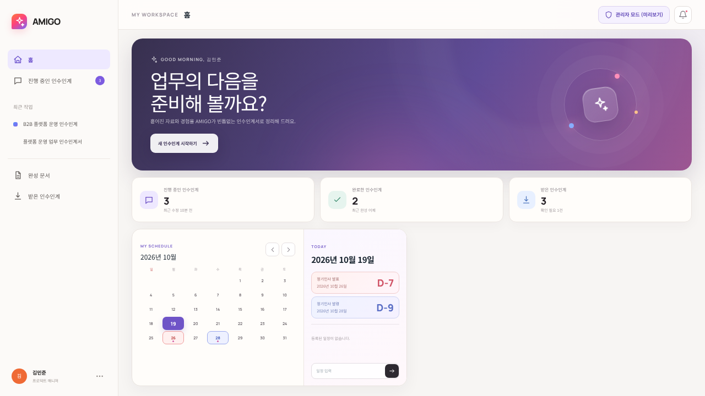
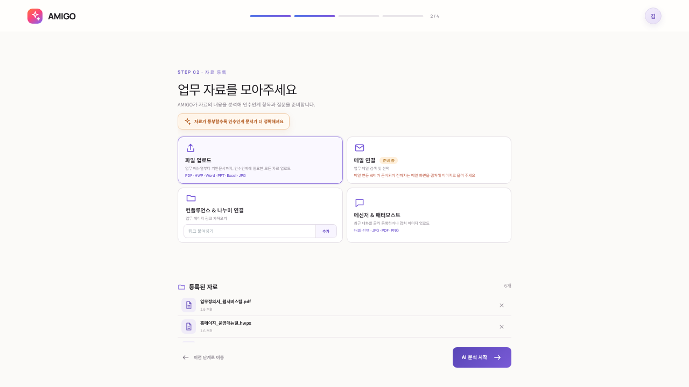
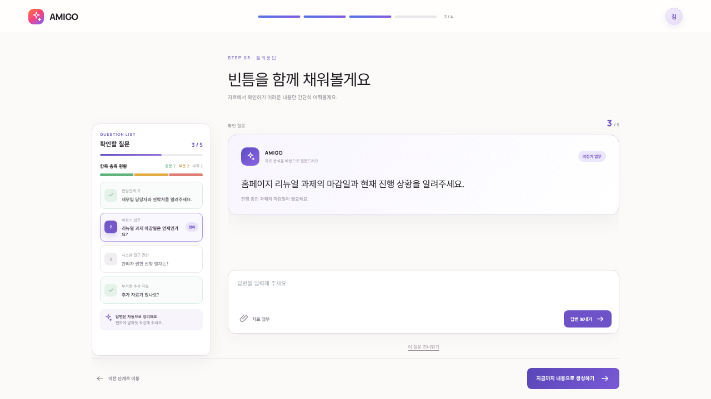
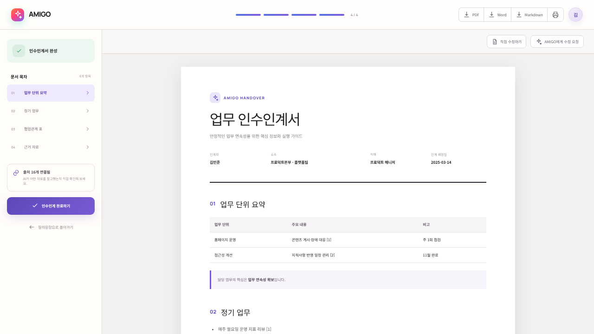
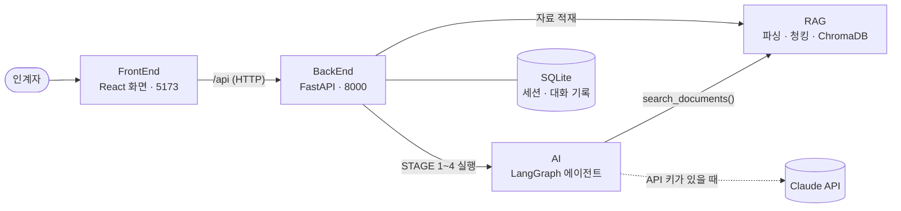

# AMIGO FrontEnd — 인수인계 도우미 화면 (React + Vite)

AI 기반 인수인계서 자동 작성 시스템 **AMIGO** 의 화면(UI/UX)입니다.
자료를 올리고, AI 의 진행 단계를 확인하며, 메신저처럼 질문에 답하고, 완성된 인수인계서를 내려받습니다.

> 화면만으로는 동작하지 않고 **BackEnd(API 서버)가 함께 떠 있어야** 합니다. 처음이라면 [실행 방법](#실행-방법)을 따라 하세요.

| 홈 대시보드 | 자료 등록 |
|---|---|
|  |  |
| **질의응답 · 항목 충족 현황** | **완성된 인수인계서** |
|  |  |

PC 브라우저 기준으로 만든 화면입니다(모바일 최적화는 하지 않았습니다).

<!-- 공통 섹션 시작 — 4개 저장소(RAG·AI·BackEnd·FrontEnd) README 에 같은 내용이 들어 있습니다. 고칠 때는 네 곳을 함께 고쳐 주세요. -->

## 전체 구성

AMIGO 는 인계자가 올린 업무 자료를 AI 가 먼저 분석하고, 자료에 없는 내용만 골라 한 번에 하나씩 질문해서
**근거(출처)가 달린 인수인계서**를 완성하는 시스템입니다. 저장소 네 개가 하나의 시스템을 이룹니다.



| 저장소 | 하는 일 | 주요 기술 |
|---|---|---|
| **[FrontEnd](https://github.com/AMIGO-KFTC/FrontEnd)** (이 저장소) | 자료 업로드(드래그 앤 드롭·링크), 진행 단계 표시, 메신저형 질의응답, 문서 뷰어·PDF/Word 다운로드 | React 19, Vite, TypeScript |
| [BackEnd](https://github.com/AMIGO-KFTC/BackEnd) | API 서버, 세션·자료·대화 DB, 업로드 파일 보관 → RAG 적재, 에이전트 백그라운드 실행, 문서 내보내기 | FastAPI, SQLAlchemy |
| [AI](https://github.com/AMIGO-KFTC/AI) | STAGE 1~4 상태 머신, 빈 항목 질문, 검색 도구 호출(Agentic RAG), 근거가 달린 문서 합성 | LangGraph, Claude API |
| [RAG](https://github.com/AMIGO-KFTC/RAG) | PDF·HWPX·Word·메일 등 파싱, 청킹·출처 메타데이터, 하이브리드 검색 `search_documents()` | ChromaDB, pdfplumber |

BackEnd 가 AI·RAG 를 **파이썬 패키지로 불러와** 한 프로세스에서 함께 실행합니다.
그래서 띄울 서버는 **BackEnd(8000 포트)** 와 **FrontEnd 개발 서버(5173 포트)** 두 개뿐입니다.

| 단계 | 화면 | 하는 일 |
|---|---|---|
| STAGE 1 자료 분석 | 진행률 바 | 인수인계서 장(인사발령 6개: 업무 단위 요약·정기업무·비정기 업무·협업관계 표·시스템 접근 권한·부서별 추가 자료 / 장기휴가 3개: 부재 중 처리할 단위 업무·세부 업무·시스템 접근 권한)별로 자료를 검색하고, 모자라면 AI 가 스스로 다시 검색 |
| STAGE 2 분석 요약 | 장별 🟢충분 🟡부분 🔴부족 | 자료로 채운 것과 비어 있는 것을 정리 |
| STAGE 3 질의응답 | 메신저형 채팅 | 빈 항목을 중요한 순서대로 **한 번에 하나씩** 질문 → 답변 정리 → "이렇게 정리했는데 맞나요?" 교차 확인 |
| STAGE 4 문서 생성 | 인수인계서 탭 | 표와 근거 번호가 달린 문서, PDF/Word 다운로드, 채팅으로 고칠 점을 말하면 새 버전 생성 |

## 실행 방법

처음 받는 사람 기준으로 **설치 → 실행 → 데모**를 순서대로 정리했습니다. 패키지를 내려받는 첫 설치는 보통 5분 안팎 걸립니다.
API 키가 없어도 규칙 기반 **오프라인 엔진**으로 전체 흐름이 동작합니다. Claude 를 쓰려면 [3. 환경 설정](#3-환경-설정-env)에서 키만 넣으면 됩니다.

### 0. 준비물

| 도구 | 버전 | 설치 |
|---|---|---|
| Git | 아무 버전 | <https://git-scm.com> |
| Python | **3.11 ~ 3.13** (3.12 권장) | macOS: `brew install python@3.12`<br>Ubuntu 24.04: `sudo apt install python3 python3-venv`<br>Windows: <https://www.python.org/downloads/> — 설치 첫 화면에서 **Add python.exe to PATH** 체크 |
| Node.js | **22 LTS** (20.19 이상) | <https://nodejs.org> 에서 LTS 버전, macOS: `brew install node@22` |
| Claude API 키 | 선택 | <https://console.anthropic.com> 에서 발급. 없으면 오프라인 엔진으로 동작 |

설치 확인: `git --version`, `python3 --version`(Windows: `python --version`), `node --version`

- 디스크 여유 공간 약 1GB(파이썬 패키지 약 650MB, npm 패키지 약 160MB)가 필요하고, 첫 설치 때 PyPI·npm 에 접속합니다.
  사내망에서 막히면 [8. 문제 해결](#8-문제-해결)의 프록시·미러 설정을 보세요.
- macOS 에 기본으로 들어 있는 `python3`(3.9)는 쓸 수 없습니다. 위 명령으로 3.12 를 설치하면 설치 스크립트가 알아서 찾아 씁니다.

### 1. 저장소 받기

네 저장소를 **한 폴더 안에 나란히** 받습니다. BackEnd 가 `../RAG`, `../AI`, `../FrontEnd` 경로로 나머지를 찾으므로 폴더 이름을 바꾸지 마세요.

```bash
mkdir amigo && cd amigo
git clone https://github.com/AMIGO-KFTC/RAG.git
git clone https://github.com/AMIGO-KFTC/AI.git
git clone https://github.com/AMIGO-KFTC/BackEnd.git
git clone https://github.com/AMIGO-KFTC/FrontEnd.git
```

```text
amigo/
├── RAG/        문서 파싱 · 검색 모듈
├── AI/         LangGraph 에이전트
├── BackEnd/    API 서버  ← 설치·실행 스크립트가 여기에 있습니다
└── FrontEnd/   화면
```

> 기본 브랜치가 아닌 브랜치(예: 아직 병합 전인 작업 브랜치)로 실행하려면 받은 뒤 각 폴더에서 `git switch <브랜치명>` 을 실행하세요.

### 2. 설치 (처음 한 번)

BackEnd 의 설치 스크립트가 다음을 한 번에 처리합니다.

1. RAG·AI 저장소가 옆에 있는지 확인
2. 파이썬 가상환경 `BackEnd/.venv` 를 만들고 RAG·AI·BackEnd 패키지를 설치
   (RAG·AI 는 *editable* 설치라서 코드를 고치면 다시 설치하지 않아도 바로 반영됩니다)
3. `BackEnd/.env` 가 없으면 `.env.example` 을 복사
4. FrontEnd 의 npm 패키지 설치

**macOS / Linux**

```bash
cd BackEnd
./scripts/setup.sh
```

**Windows (PowerShell)**

```powershell
cd BackEnd
powershell -ExecutionPolicy Bypass -File scripts\setup.ps1
```

마지막에 `✔ 준비 완료`(Windows 는 `Done.`)가 보이면 성공입니다. 다시 실행해도 안전합니다(있는 것은 그대로 두고 빠진 패키지만 설치).
파이썬이 여러 개 깔려 있으면 쓸 파이썬을 지정할 수 있습니다: `PYTHON=python3.12 ./scripts/setup.sh`
(Windows: `powershell -ExecutionPolicy Bypass -File scripts\setup.ps1 -Python C:\경로\python.exe`)

<details>
<summary>스크립트 없이 직접 설치하기</summary>

macOS / Linux:

```bash
cd BackEnd
python3.12 -m venv .venv
source .venv/bin/activate
python -m pip install --upgrade pip
pip install -r requirements-dev.txt      # -e ../RAG, -e ../AI 가 함께 설치됩니다
cp .env.example .env
cd ../FrontEnd && npm install
```

Windows (PowerShell):

```powershell
cd BackEnd
py -3.12 -m venv .venv
.venv\Scripts\Activate.ps1
python -m pip install --upgrade pip
pip install -r requirements-dev.txt
copy .env.example .env
cd ..\FrontEnd; npm install
```

</details>

### 3. 환경 설정 (.env)

설정 파일은 `BackEnd/.env` 하나입니다. **처음에는 그대로 두고 실행해도 됩니다.**

| 하고 싶은 것 | `BackEnd/.env` 에 적을 내용 |
|---|---|
| API 키 없이 시연 (기본) | 그대로 두기 → 규칙 기반 오프라인 엔진 |
| Claude 로 실제 분석 | `ANTHROPIC_API_KEY=sk-ant-...` |
| 모델 바꾸기 | `AMIGO_LLM_MODEL=claude-haiku-4-5`(기본, 가장 저렴) / `claude-sonnet-5-5`(약 2배) / `claude-opus-5-5`(약 4배, 품질 가장 좋음) |
| 키가 있어도 오프라인 엔진으로 | `AMIGO_LLM_MODE=offline` |
| Claude API 비용 상한 두기 | `AMIGO_LLM_BUDGET_USD=10` (모든 작업 합계가 $10 를 넘으면 새 AI 작업을 막음, 0 이면 제한 없음) |
| 컨플루언스 링크 수집 | `CONFLUENCE_BASE_URL` + `CONFLUENCE_PAT`(Server/DC), Cloud 는 `CONFLUENCE_EMAIL` + `CONFLUENCE_API_TOKEN` |
| 나누미 링크 수집 | `NANUMI_BASE_URL` + `NANUMI_COOKIE` |

- Claude 사용량은 <http://localhost:8000/api/usage> 에서 **전체 누적 추정 비용·토큰 수와 남은 예산**을, 각 작업의 사용량은 `GET /api/sessions/{id}/state` 응답의 `usage` 로 확인합니다(새 디자인 화면에는 아직 사용량 배지가 없습니다). 추정치이므로 실제 청구액은 <https://platform.claude.com> 의 Usage 에서 확인하고, 그곳의 Limits 에서 월 사용 한도도 걸어 두세요.
- `.env` 를 고친 뒤에는 백엔드를 껐다가 다시 켭니다(코드 변경 시 자동 재시작은 `.env` 변경을 감지하지 않습니다).
- 지금 쓰는 엔진은 <http://localhost:8000/api/health> 의 `"engine"` 값(`claude` / `offline`)으로 확인합니다.
- `.env` 는 `.gitignore` 에 들어 있어 커밋되지 않습니다. API 키를 `.env.example`·코드·채팅에 적지 마세요.
- 오프라인 엔진은 표 머리글과 정규식으로 항목을 뽑는 **시연용**이라 문장이 거칠고 질문도 정해진 틀을 씁니다. 실제 품질은 Claude 로 확인하세요.
- 전체 설정 목록은 [BackEnd README 의 환경변수](https://github.com/AMIGO-KFTC/BackEnd#환경변수)에 있습니다.

### 4. 실행

터미널을 두 개 열어 백엔드와 프론트엔드를 각각 실행합니다.

**터미널 1 — 백엔드(API 서버)**

macOS / Linux:

```bash
cd BackEnd
./scripts/dev.sh
```

Windows (PowerShell):

```powershell
cd BackEnd
powershell -ExecutionPolicy Bypass -File scripts\dev.ps1
```

`Application startup complete.` 가 보이면 준비된 것입니다. <http://localhost:8000/docs> 에서 API 문서(Swagger)를 볼 수 있습니다.

**터미널 2 — 프론트엔드(화면)** — 모든 OS 공통

```bash
cd FrontEnd
npm run dev
```

브라우저에서 **<http://localhost:5173>** 을 엽니다. 화면의 `/api` 요청은 Vite 개발 서버가 백엔드(8000)로 전달합니다.

**한 번에 실행하기** — 둘 다 띄우는 스크립트도 있습니다.

macOS / Linux: 터미널 하나에서 함께 실행되고 `Ctrl+C` 로 둘 다 종료됩니다.

```bash
cd BackEnd
./scripts/start-all.sh
```

Windows (PowerShell): 백엔드·프론트엔드 창이 하나씩 새로 열립니다.

```powershell
cd BackEnd
powershell -ExecutionPolicy Bypass -File scripts\start-all.ps1
```

- **코드를 고치면** 바로 반영됩니다. 백엔드는 BackEnd·AI·RAG 의 `.py` 파일이 바뀌면 스스로 다시 시작하고, 화면은 저장하는 즉시 바뀝니다.
- 끌 때는 각 터미널에서 `Ctrl+C` 를 누릅니다.
- **8000 포트를 이미 쓰고 있다면** 다른 포트로 띄우고, 프론트엔드에도 그 주소를 알려 줍니다(예: 8001).

| | macOS / Linux | Windows (PowerShell) |
|---|---|---|
| 백엔드 | `PORT=8001 ./scripts/dev.sh` | `powershell -ExecutionPolicy Bypass -File scripts\dev.ps1 -Port 8001` |
| 프론트엔드 | `AMIGO_API=http://localhost:8001 npm run dev` | `$env:AMIGO_API="http://localhost:8001"; npm run dev` |
| 함께 실행 | `PORT=8001 ./scripts/start-all.sh` | `powershell -ExecutionPolicy Bypass -File scripts\start-all.ps1 -Port 8001` |

### 5. 데모 따라 하기 (5분)

RAG 저장소의 `samples/` 폴더(`amigo/RAG/samples/`)에 가상의 웹서비스팀 인수인계 자료 6종이 있습니다(등장하는 기관·인물·연락처는 모두 가상).

| 파일 | 내용 |
|---|---|
| `업무정의서_웹서비스팀.pdf` | 업무 개요, 주요 업무·반복 업무 표, 유관 부서, 유의사항 |
| `홈페이지_운영매뉴얼.hwpx` | 한글 문서: 사용 시스템과 권한 신청 방법 |
| `주간회의록_2026-09-22.docx` | 진행 중인 과제 현황(리뉴얼, 개인정보처리방침 개정 등) |
| `재무팀_유지보수대금_요청.eml` | 재무팀 메일(발신자·일시 메타데이터) + 첨부 검수 체크리스트 |
| `시스템_계정목록.xlsx` | 시스템 계정 목록, 연간 일정 |
| `웹접근성_개선계획.pptx` | 웹 접근성 지적사항과 추진 일정 |

1. <http://localhost:5173> 에서 로그인합니다. 계정이 없으면 <http://localhost:8000/docs> 의 `POST /api/auth/signup` 에 아이디·비밀번호(8자 이상)·이름을 넣어 만듭니다
   (화면의 회원가입·비밀번호 재설정 양식은 아직 서버와 연결되지 않았습니다).
2. 홈에서 **새 인수인계 시작하기** → **정기인사 인수인계 시작** → 기본 정보를 적습니다. 이름·소속·직책은 프로필에서 채워지고, 담당 업무를 하나 이상 넣어야 다음으로 넘어갑니다.
3. 자료 등록 화면의 **파일 업로드** 칸에 `RAG/samples/` 의 파일 6개를 끌어다 놓습니다(칸을 클릭해서 골라도 됩니다). 등록한 자료 목록에서 모두 처리 완료가 될 때까지 기다립니다.
   - **컨플루언스 & 나누미 연결** 에 주소를 붙여 넣으면 링크도 자료로 등록됩니다.
     접속할 수 없는 주소면 실패 표시와 사유가 나오고, 나머지 자료만으로 계속 진행할 수 있습니다.
   - **메신저 & 매터모스트** 는 BackEnd 의 가상 Mattermost·Confluence 데이터를 보여 주며, 체크해서 자료로 등록합니다.
4. **AI 분석 시작** → 분석 화면의 진행률이 STAGE 1(장별 분석) → STAGE 2(요약)로 올라가고, 끝나면 **질의응답 시작** 을 누릅니다.
5. STAGE 3 — 대화창에 첫 질문이 옵니다. 아는 내용을 자유롭게 답하면 AI 가 정리해서 맞는지 되묻습니다. 왼쪽 **확인할 질문** 목록과 **항목 충족 현황**이 함께 바뀝니다.
   - 예: 재무팀 연락처를 물으면 `재무팀 박지훈 차장, 내선 2345` 라고 답하기 → 정리된 내용 확인 → **네, 맞아요**
   - 틀렸으면 고칠 내용을 그대로 적고, 모르는 질문은 **이 질문 건너뛰기** 를 누릅니다.
6. 질문이 끝나거나 **지금까지 내용으로 생성하기** 를 누르면 STAGE 4 로 넘어가 생성 중 화면을 거쳐 **인수인계서**가 나타납니다.
7. 문서 위쪽 버튼으로 **PDF / Word / Markdown** 을 내려받습니다. 표의 `[1]` 같은 번호는 문서 끝 **근거 자료** 목록(파일명·페이지·메일 발신자)과 연결됩니다.
8. **수정 요청 보내기** 에 `협업 관계에 총무팀 최OO 주임(내선 3456)도 추가해 주세요` 처럼 고칠 점을 적으면 반영된 **v2** 문서가 만들어집니다.
9. **인수인계 완료하기** → 완료 화면 → **홈으로 돌아가기**. 완성된 문서는 홈의 **완성 문서**에서 다시 열 수 있습니다.

진행 상황은 서버에 저장되므로, 브라우저를 닫거나 서버를 다시 켜도 홈의 **진행 중인 인수인계**에서 **이어서 작성**으로 저장된 단계부터 계속할 수 있습니다.
작업 화면 주소(`#/s/<세션ID>/<단계>`)를 북마크해 두면 로그인 뒤 바로 그 화면으로 돌아옵니다.

### 6. (선택) 서버 하나로 실행하기 — 시연·공유용

화면을 빌드해 두면 백엔드가 화면까지 함께 제공하므로 8000 포트 하나로 동작합니다.

1. 화면 빌드: FrontEnd 폴더에서 `npm run build` → `FrontEnd/dist/` 가 생깁니다.
2. `BackEnd/.env` 에서 `# AMIGO_FRONTEND_DIST=../FrontEnd/dist` 줄 맨 앞의 `#` 을 지웁니다.
3. 백엔드를 [4. 실행](#4-실행)과 같이 띄우면 **<http://localhost:8000>** 에서 화면과 API 가 함께 열립니다.

같은 네트워크의 다른 PC 에서도 열어 보게 하려면 BackEnd 폴더에서 다음처럼 실행하고 `http://<내 PC IP>:8000` 으로 접속합니다.

```bash
.venv/bin/python -m uvicorn app.main:app --host 0.0.0.0 --port 8000        # Windows: .venv\Scripts\python -m uvicorn ...
```

로그인은 BackEnd 의 자체 계정(회원가입 API)으로만 동작하는 **프로토타입**이므로 사내망 시연에만 쓰고, 실제 업무 자료를 다루는 서버는 사내 SSO 를 붙이고 HTTPS(`AMIGO_COOKIE_SECURE=true`)로 운영하세요.

### 7. 테스트

모든 테스트는 오프라인 엔진으로 돌기 때문에 API 키 없이 실행됩니다. BackEnd 가상환경 하나로 세 파이썬 저장소를 모두 테스트할 수 있습니다.

macOS / Linux (amigo 폴더에서):

```bash
cd BackEnd     && .venv/bin/python -m pytest -q
cd ../RAG      && ../BackEnd/.venv/bin/python -m pytest -q
cd ../AI       && ../BackEnd/.venv/bin/python -m pytest -q
cd ../FrontEnd && npm run build
```

Windows (PowerShell, amigo 폴더에서):

```powershell
cd BackEnd;     .venv\Scripts\python -m pytest -q
cd ..\RAG;      ..\BackEnd\.venv\Scripts\python -m pytest -q
cd ..\AI;       ..\BackEnd\.venv\Scripts\python -m pytest -q
cd ..\FrontEnd; npm run build
```

| 저장소 | 확인하는 것 |
|---|---|
| BackEnd | 업로드 → 분석 → 질의응답 → 문서 생성 → 다운로드 API 통합 흐름, `.env` 읽기, Word/PDF 변환 |
| RAG | 형식별 파서(PDF·HWPX·HWP·Office·메일·ZIP), 청킹, 링크 수집 보안 검사, 하이브리드 검색 |
| AI | 상태 머신 전체 흐름(오프라인 엔진), 가짜 Anthropic 클라이언트로 Claude 호출 형식, 문서 렌더링 |
| FrontEnd | TypeScript 타입 검사 + 프로덕션 빌드 |

### 8. 문제 해결

| 증상 | 해결 |
|---|---|
| 설치 스크립트가 `RAG 가 없습니다` / `-e ../RAG` 설치 실패 | 네 저장소를 같은 폴더에 받았는지, 폴더 이름이 정확히 `RAG`, `AI`, `BackEnd`, `FrontEnd` 인지 확인 |
| `Python 3.9 은(는) 지원하지 않습니다` | Python 3.12 를 설치한 뒤 `PYTHON=python3.12 ./scripts/setup.sh` |
| Ubuntu: `ensurepip is not available` | `sudo apt install python3-venv`(3.12 를 따로 설치했다면 `python3.12-venv`) 후 다시 실행 |
| Windows: `이 시스템에서 스크립트를 실행할 수 없으므로 …` | `.ps1` 은 안내대로 `powershell -ExecutionPolicy Bypass -File …` 로 실행합니다. `npm` 이나 `Activate.ps1` 에서 같은 오류가 나면 `Set-ExecutionPolicy -Scope CurrentUser RemoteSigned` 를 한 번 실행하거나 `npm.cmd run dev` 처럼 실행 |
| 사내망에서 `pip install` / `npm install` 이 멈추거나 SSL 오류 | 프록시: `pip config set global.proxy http://프록시:포트`, `npm config set proxy http://프록시:포트`, `npm config set https-proxy http://프록시:포트`<br>사내 미러: `pip config set global.index-url <미러 주소>`, `npm config set registry <미러 주소>`<br>SSL 검사 장비가 있으면 회사 인증서 지정: `pip config set global.cert <인증서.pem>`, `npm config set cafile <인증서.pem>` |
| `npm run dev` 가 Node.js 버전 오류로 실패 | Node.js 22 LTS 로 올린 뒤 FrontEnd 에서 `npm install` 을 다시 실행 |
| 백엔드 실행 시 `address already in use` | 이미 떠 있는 서버를 끄거나 다른 포트로 실행([4. 실행](#4-실행)의 포트 변경 참고) |
| 화면에 `서버에 연결할 수 없습니다` | 백엔드가 떠 있는지 <http://localhost:8000/api/health> 로 확인. 포트를 바꿨다면 `AMIGO_API` 도 맞춰서 프론트엔드를 다시 실행 |
| 링크 등록이 실패(DNS·연결 오류) | 사내 위키·나누미는 사내망 PC 에서만 열립니다. 인증이 필요한 주소는 [3. 환경 설정](#3-환경-설정-env)의 컨플루언스·나누미 설정을 채우세요 |
| 내려받은 PDF 의 한글이 깨지거나 글꼴이 이상함 | 서버에 한글 TTF 글꼴이 없는 경우입니다. Linux: `sudo apt install fonts-nanum`, 또는 `.env` 에 `AMIGO_PDF_FONT=<글꼴 .ttf 경로>` 지정 후 백엔드 재시작 |
| `AI가 이전 요청을 처리하고 있어요` (409) | AI 가 앞 요청을 처리 중입니다. 대화창의 입력 중 표시(…)가 사라진 뒤 다시 보내세요 |
| 대화창에 오류 메시지와 **다시 시도** 버튼 | API 키·네트워크·사용량 한도 문제일 수 있습니다. 백엔드 터미널의 로그를 확인한 뒤 **다시 시도** |
| Linux 에서 `unsupported version of sqlite3` (ChromaDB) | 배포판의 sqlite 가 3.35 보다 오래된 경우입니다(Ubuntu 20.04, RHEL 8 등). Ubuntu 22.04 이상을 쓰거나 [uv](https://docs.astral.sh/uv/) 로 설치한 Python(`uv python install 3.12`)을 `PYTHON=` 으로 지정 |
| 처음 상태로 되돌리기 | 백엔드를 끄고 `BackEnd/data/` 폴더를 지우면 세션·업로드 파일·지식베이스가 모두 초기화됩니다 |

### 9. 최신 코드로 업데이트

네 저장소를 모두 최신으로 받은 뒤, 패키지가 바뀌었을 수 있으니 설치 스크립트를 한 번 더 실행합니다(이미 설치된 것은 건너뜀).

```bash
cd amigo
for repo in RAG AI BackEnd FrontEnd; do git -C $repo pull; done
cd BackEnd && ./scripts/setup.sh
```

Windows (PowerShell):

```powershell
cd amigo
foreach ($repo in "RAG", "AI", "BackEnd", "FrontEnd") { git -C $repo pull }
cd BackEnd; powershell -ExecutionPolicy Bypass -File scripts\setup.ps1
```

<!-- 공통 섹션 끝 -->

## 화면 검증

Figma Make 로 만든 새 디자인을 BackEnd 연동 화면에 적용한 결과와 검증 내용은 [docs/design-integration-verification.md](docs/design-integration-verification.md) 에 있습니다
(적용 범위, 기존 기능 유지 여부, 가짜 응답·실제 서버 검증 결과, 미검증 항목, 실제 Claude 엔진으로 확인하는 방법).

| 스크립트 | 하는 일 | 실행 |
|---|---|---|
| `scripts/capture-screens.mjs` | `/api` 를 가짜 응답으로 바꿔 86개 화면·이동·복원·오류 시나리오를 캡처하고, 이동만 한 시나리오에서 변경 요청(POST/PUT/DELETE)이 나가지 않는지 확인 | `npm run dev` 를 띄운 뒤 `npx playwright install chromium` → `node scripts/capture-screens.mjs out` |
| `scripts/integration-check.mjs` | 실제 BackEnd 를 상대로 회원가입 → 로그인 → 업로드 → 분석 → 질의응답 → 문서 생성 → 다운로드 → 복원·삭제까지 브라우저로 확인 | BackEnd·개발 서버를 띄운 뒤 `node scripts/integration-check.mjs` (테스트 계정은 `AMIGO_TEST_ID`·`AMIGO_TEST_PASSWORD`, 없으면 임의 계정 가입) |

두 스크립트 모두 전역 또는 프로젝트의 `playwright` 패키지를 사용하며, 비밀번호는 출력하지 않습니다.

## 이 저장소만 개발하기

Node.js 22 LTS(20.19 이상)가 필요합니다. 백엔드를 먼저 띄워 둔 상태에서(오프라인 엔진이면 API 키 없이 됩니다) 다음을 실행합니다.

```bash
cd FrontEnd
npm install
npm run dev          # http://localhost:5173 — /api 요청은 http://localhost:8000 으로 프록시
npm run typecheck    # 타입 검사만
npm run build        # 타입 검사 + dist/ 생성
npm run preview      # 빌드 결과를 http://localhost:4173 에서 미리 보기(/api 프록시 동일)
```

- 다른 주소의 백엔드를 쓰려면 `AMIGO_API=http://서버:8000 npm run dev`(Windows: `$env:AMIGO_API="http://서버:8000"; npm run dev`).
- API 응답 타입은 `src/shared/types.ts` 에 있고 BackEnd 의 `app/schemas.py` 와 짝을 이룹니다. 응답 구조를 바꿀 때는 두 곳을 함께 고칩니다.
- 팀 관리 모드는 서버가 `is_admin: true`(관리자 권한, 팀장)로 알려 준 계정만 열 수 있습니다.
  - 팀장은 로그인 뒤 **인수인계 작성 / 팀 관리** 중 하나를 고릅니다. 선택은 탭을 닫거나 로그아웃할 때까지 유지됩니다.
  - 홈 머리글의 **팀 관리 모드** 단추와 관리자 머리글의 **일반 모드** 단추로 두 모드를 오갑니다.
- 이전 3단 작업 화면은 `legacy.html`(`src/legacy/`)로 남겨 두었습니다. 개발 서버에서 <http://localhost:5173/legacy.html> 로 열 수 있습니다.
- `npm run build` 결과물(`dist/`)은 BackEnd 의 `AMIGO_FRONTEND_DIST=../FrontEnd/dist` 설정으로 8000 포트 하나에서 함께 서비스할 수 있습니다([서버 하나로 실행하기](#6-선택-서버-하나로-실행하기--시연공유용)).

## 화면 구성

주소창 해시로 화면을 구분합니다. 로그인 전에는 로그인 화면이 보이고, 로그인하면 보려던 주소로 돌아갑니다.

| 주소 | 화면 | 컴포넌트 | 내용 |
|---|---|---|---|
| (로그인 전) | 로그인 · 회원가입 · 비밀번호 재설정 | `screens/auth/` | 로그인은 `/api/auth/login`, 만료(401) 시 안내 후 재로그인. 회원가입·비밀번호 재설정 양식은 서버 미연결 |
| `#/` | 홈 대시보드 | `screens/home/DashboardScreen` | 진행 중·완료 건수(서버 세션 목록), 새 인수인계 시작, 알림·캘린더(예시 값, 서버 미연결) |
| `#/home/handover` | 진행 중인 인수인계 | `screens/home/OngoingHandoverScreen` | 문서가 아직 없는 세션 목록, 저장된 단계로 **이어서 작성**, 확인창 뒤 삭제(`DELETE /api/sessions/{id}`) |
| `#/home/documents` | 완성 문서 | `screens/home/CompletedDocumentsScreen` | 문서가 있는 세션 목록, 문서 열기 |
| `#/home/received` | 받은 인수인계 | `screens/home/ReceivedHandoverScreen` | `GET /api/handovers/received`. 인수자는 문서 열기·PDF 내려받기만(읽기 전용) |
| `#/admin`, `#/admin/<tab>` | 팀 관리 모드 | `screens/admin/` | 관리자(`is_admin`)만. 구성원(`/api/admin/members`)·팀 인수인계(`/api/admin/handovers`)·팀 인수인계 항목·AI 맞춤 설정. 일반 구성원이 들어오면 홈으로 |
| `#/new`, `#/new/<유형>` | 유형 선택 · 기본 정보 | `HandoverTypeScreen`, `StartScreen` | 정기인사 / 장기휴가 선택, 인계자 정보 입력 → `POST /api/sessions` |
| `#/s/<세션ID>/upload` | 자료 등록 | `UploadStepScreen` + `MattermostPanel`, `ConfluencePanel` | 드래그 앤 드롭 업로드(PDF·HWPX/HWP·Word·PPT·Excel·메일·소스코드·ZIP), 링크 등록, 가상 Mattermost·Confluence 선택, 처리 상태(대기/처리 중/완료/실패 사유), 분석 시작 |
| `#/s/<세션ID>/processing` | 분석 | `ProcessingScreen` | STAGE 1~2 진행률·현재 작업 문구, 실패 시 다시 시도 |
| `#/s/<세션ID>/question` | 질의응답 | `QuestionScreen` | 메신저형 대화(질문·확인 요청·추천 답변·건너뛰기·대화 중 자료 첨부), 왼쪽 확인할 질문 목록, 항목 충족 현황, 문서 생성 |
| `#/s/<세션ID>/generating` | 생성 중 | `GeneratingDocumentScreen` | STAGE 4 진행 표시(서버 상태 기준), 실패 시 다시 시도 |
| `#/s/<세션ID>/document` | 인수인계서 | `FinalDocumentScreen` + `shared/GanttTable`, `MermaidDiagram` | Markdown 뷰어(표·근거 번호·간트 표·관계도), PDF/Word/Markdown 다운로드, 수정 요청(새 버전 생성) |
| `#/s/<세션ID>/complete` | 완료 | `CompletionScreen` | 완료 안내, 홈·새 인수인계로 이동 |

장기휴가 유형은 같은 단계 화면에 바다 테마 배경(`shared/LeaveSeasideBackground`)이 깔립니다.

## 백엔드 연동 방식

- `src/shared/api.ts` 에 모든 API 호출이 있습니다. 오류는 서버의 `detail` 메시지를 그대로 화면에 보여 주고, `ApiError.status` 로 401(로그인 만료)·403·404(열 수 없는 작업)·5xx 를 구분합니다.
- 로그인하면 BackEnd 가 HttpOnly 쿠키를 내려 주고, 이후 요청은 그 쿠키로 사용자를 구분합니다(유효 시간은 BackEnd 의 `AMIGO_SESSION_TTL_HOURS`).
  로그인하지 않은 요청은 브라우저별 임의 ID 를 `X-User-Id` 헤더로 보내는 프로토타입 방식으로 구분합니다.
- `src/shared/useSessionState.ts` 가 `GET /api/sessions/{id}/state?after=<마지막 메시지 ID>` 를 폴링합니다.
  AI 가 처리 중이거나 자료를 적재 중이면 1초, 그 외에는 4초 간격으로 새 메시지만 받아 이어 붙입니다.
- 분석·답변·문서 생성·수정 요청은 서버가 202 로 바로 응답하고 백그라운드에서 처리하므로, 화면은 폴링 결과로 진행 상황을 그립니다.
  서버 단계(`setup → analyzing → summary → qna → composing → review`)가 바뀌면 `src/shared/router.ts` 의 `resolveStep` 이 그 단계에 맞는 화면으로 주소를 바꿉니다.
- 주소창 해시(`#/s/<세션ID>/<단계>`)로 현재 작업과 단계를 기억해 새로고침·뒤로 가기·북마크로 돌아와도 이어서 작업하며, 이동만으로는 변경 요청(POST/PUT/DELETE)을 보내지 않습니다. 예전 주소 `#/s/<세션ID>` 도 그대로 동작합니다.

## 폴더 구조

```text
.github/CODEOWNERS         코드 소유자 지정
index.html / legacy.html   새 디자인 화면 / 이전 3단 화면(보존용) 진입점
src/
  main.tsx                 진입점
  App.tsx                  로그인 상태, 세션 목록, 단계 전환, 화면 선택
  index.css                디자인 토큰·화면 스타일·애니메이션(Figma Make 디자인 + BackEnd 연동용 보완 규칙)
  shared/
    api.ts / types.ts      API 클라이언트와 응답 타입(BackEnd/app/schemas.py 와 짝)
    router.ts              주소 해시 파싱·이동, 서버 단계별 허용 화면
    useSessionState.ts     상태 폴링
    sessions.ts            세션 목록 분류(진행 중/완성), 단계·상태 표시 문구
    profile.tsx            서버 프로필(/api/auth/me) 공유
    AppSidebar.tsx  StepUserMenu.tsx  ConfirmModal.tsx  LogoutConfirmModal.tsx
    Icon.tsx  Brand.tsx  LeaveSeasideBackground.tsx  ErrorNote.tsx
    documentMarkdown.ts  GanttTable.tsx  MermaidDiagram.tsx  highlight.tsx  handover.ts  restore.ts
  screens/
    auth/      LoginScreen  SignupScreen  ForgotPasswordScreen  AuthVisual
               WorkspaceSelectScreen(팀장의 일반 / 팀 관리 모드 선택)
    home/      DashboardScreen  OngoingHandoverScreen  CompletedDocumentsScreen  ReceivedHandoverScreen  DashboardCalendar
    admin/     AdminDashboardScreen  AdminMembersPage  AdminHandoversPage  AdminAiSettingsPage
    handover/  HandoverTypeScreen  StartScreen  UploadStepScreen  MattermostPanel  ConfluencePanel
               ProcessingScreen  QuestionScreen  GeneratingDocumentScreen  FinalDocumentScreen
               CompletionScreen  SessionGateScreen
  legacy/                  이전 3단 작업 화면(legacy.html 에서만 사용)
scripts/
  capture-screens.mjs      가짜 응답 화면 캡처·이동 검증
  integration-check.mjs    실제 BackEnd 통합 검증
docs/
  design-integration-verification.md   디자인 통합·검증 결과
  screenshots/             README 화면 캡처
public/favicon.svg
vite.config.ts             개발 서버(5173), /api 프록시(AMIGO_API), @/ 별칭, 두 진입점 빌드
```
